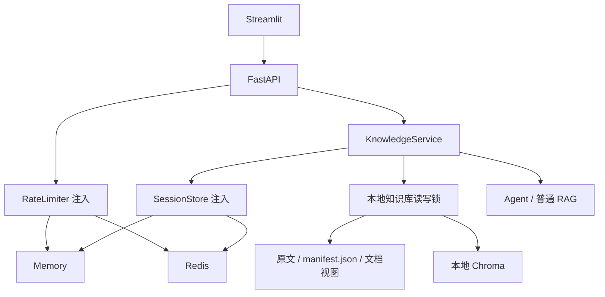

# Redis 状态管理设计与验证

## 范围与架构



会话和限流可跨进程共享；知识库仍由本地单点和单一写入进程管理。CLI 保持独立进程内历史，不与 Web 共享。两种状态后端分别配置，切换后不迁移内存会话。

## 会话临界区和故障语义

1. 校验请求并完成双层限流。
2. `SET NX PX` 获取会话锁，不排队；被占用立即返回 409。
3. 持锁读取历史，最多保存六轮完整问答。
4. 持锁执行改写、检索和生成；不同会话可同时生成。
5. Lua 原子校验锁、按 request ID 去重、追加、裁剪并设置 24 小时 TTL。
6. Lua 比较 token 后释放锁。清空会话使用同一把锁。

默认 lease 60 秒，每 15 秒由 watchdog 比较 token 并续租。网络故障或 token 不符时标记执行权丢失，停止后续工作，禁止提交；提交脚本再次检查持有者。这个方案不等于 Redis 高可用故障切换下的强一致锁。

总体问答预算默认 300 秒，模型单次调用最多 60 秒，追问改写最多 10 秒；同时受剩余预算限制。Embedding 请求超时为 30 秒，禁用模型客户端的隐式重试。同步底层操作不能任意强杀，截止时间在调用前后、流式片段和工具事件处检查；超时的残留操作返回后不能提交历史。

每个 List 元素包含 `request_id/question/answer`，不是两条独立的消息写入。提交遇到连接/超时故障时最多三次尝试，退避 100/200 ms；响应丢失后同一个 request ID 不重复追加。脚本在写入前校验类型和参数；Lua 提供不可交错执行，不提供错误回滚。

生成成功但提交结果无法确认时，保留答案并返回 `history_status=unconfirmed` 及页面警告，不自动重新生成。此时既可能未保存，也可能已保存但确认响应丢失。request ID 只用于本次提交重试，不代表整个 HTTP 接口实现了端到端幂等重放。

## 限流

- 问答 IP + Session：默认 20 次 / 60 秒。
- 问答 IP 总额度：默认 60 次 / 60 秒，防止匿名换 Session 绕过。
- 上传 IP：默认 5 次 / 60 秒。

采用 ZSET + Lua 的滑动窗口，Redis `TIME` 统一时钟。一次脚本检查全部维度，仅全部允许时一起计入；记录有 TTL，拒绝请求不重复增加窗口成员。`Retry-After` 取所有受限维度最早记录离开窗口所需时间的最大值，向上取整。Memory 实现使用可注入单调时钟及进程锁，语义保持一致。

已通过限流但最终 409 或生成失败的请求仍占额度。当前 API 看到的通常是 Streamlit 服务 IP；没有认证，不能声称能准确识别所有终端用户。公开部署需要可信身份/代理配置，不直接相信任意 `X-Forwarded-For`。

## 上下文和生成行为

Web 普通 RAG 无历史时直接检索，有历史时先生成独立检索问题，例如“它的缺点”改写为“混合检索有哪些缺点”。改写仅补充已有上下文，不回答问题、不编造事实；改写失败返回服务错误。

生成使用原问题、历史和参考资料。最多读取六轮，优先丢弃旧的完整问答；最新一轮过长时裁剪内容，保留追问关联。历史预算为 2,000 个 UTF-8 字节，整体提示输入预算为 8,000 个保守估算单位（UTF-8 字节数），输出最多 2,048 token。字节计数不是 DeepSeek 精确分词结果，不将它描述为精确 token 数；仍需依据真实 `usage` 观察及评估。

普通 RAG 超预算先移除旧历史，再裁剪参考内容；问题及固定规则本身超预算则拒绝，避免悄悄截断当前问题。Agent 搜索工具单片段最多传入 1,800 字节，整体超预算先移除历史，再移除旧的完整 assistant/tool 组，不留下孤立的 tool 消息；最新工具组仍超预算则拒绝，不丢掉唯一证据继续生成。来源面板保留检索结果，普通 RAG 提示词可能仅使用其预算内前缀，不能将检索来源等同于逐句证据校验。

## 知识库读写锁

原来的全局锁覆盖了整个 LLM 调用，现在改为进程内、写优先的读写锁：

- 查询向量的 Embedding 在锁外计算，标题匹配与 Chroma 查询在读锁内取得一致视图。
- 上传校验、解析和向量化在锁外完成；写锁内重新读取清单、写入预计算向量、清理旧版本并发布文档视图。
- LLM 生成阶段不持知识库锁；Agent 每次搜索工具单独获取读锁。
- 上传发布和检索互斥，检索可能短暂等待；不保证与上传完全无等待。

LangChain 的预计算向量写入封装在 `src/vector_store.py` 中，底层 collection 访问不散落业务模块，并用真实本地 Chroma 测试覆盖。没有新增文档删除接口或按钮。

## 探针、超时和日志

Redis 配置在 API lifespan 启动阶段校验并 PING；任一 Redis 后端启用时 URL 必填。连接 0.5 秒、命令 1 秒，连接池有上限，禁用 SDK 额外重试；不接受 URL 查询参数覆盖这些设置。服务退出关闭客户端连接池。

`/health` 是存活检查。`/ready` 检查已配置的会话/限流依赖，不调用付费 API，也不证明模型和完整知识库链路已可用。Redis 故障期间，问答、Redis 会话清空、Redis 限流保护的上传返回 503；本地文档列表和预览不单独依赖 Redis。恢复后连接池重连，不需重启 API。

SSE 开始前完成限流、会话锁和历史读取，异常可返回 HTTP 409/503。开始后只能发送 `error` 事件，不能更改已发送的 HTTP 状态；只有 `done` 确认完成，保存警告随 `done` 传递。流式队列有界，断连或初始化超时设置取消标志；每 10 秒空闲发送 keepalive。

日志记录事件名、耗时、错误类型、请求 ID、锁冲突、续租失败、限流拒绝和提交重试，不记录 Redis URL、锁 token、聊天正文或原始 SDK 异常。URL 可能含密码，不把它拼接进错误体或日志。当前不引入额外监控平台。

## 可复现测试

```powershell
python -m pip install -r requirements-dev.txt
python -m pytest
```

离线测试在 OpenAI 兼容 SDK 的 Chat/Embedding 入口拦截未 Mock 调用；真实模型测试仍使用原有 `integration` 标记。Redis 测试使用 `redis` 标记，不消耗模型额度。

- 同会话并发：FakeLLM 用 Event 通知已进入，再阻塞；第二请求稳定得到 409，释放 Event 后第一请求成功。
- 不同会话：要求两个 FakeLLM 都进入生成阶段，证明没有全局生成锁。
- 提交半失败：先执行提交脚本再抛超时，重试后仍只有一轮历史。
- 锁失效：更换 token，旧请求不能提交、续租或删除新锁。
- 真实 Chroma：验证上传仅向量化一次，预计算写入后可检索，重启后仍保留。

启动本地 Redis 后运行真实跨进程测试：

```powershell
$env:TEST_REDIS_URL="redis://127.0.0.1:6379/0"
python -m pytest tests/test_redis_processes.py -q
```

测试自动选取两个空闲本机端口，以 `--workers 1` 分别启动独立 Uvicorn；使用独立临时目录和随机 Redis 前缀，结束只清理该前缀，不清空数据库。交替请求验证共享历史及四次会话额度，第五次由任一实例统一返回 429；文件屏障控制生成阻塞，验证跨进程 409。

手动检查时，可在两个终端设置相同测试配置：

```powershell
$env:SESSION_BACKEND="redis"
$env:RATE_LIMIT_BACKEND="redis"
$env:REDIS_URL="redis://127.0.0.1:6379/0"
$env:REDIS_KEY_PREFIX="rag-manual-test"
python -m uvicorn tests.support.redis_app:app --host 127.0.0.1 --port 8001 --workers 1
# 另一个终端重复上述变量设置，端口改为 8002
```

测试入口使用离线模型，不读取生产知识库；不能作为正常产品启动入口。

若要停止/恢复容器进行故障注入，必须使用专用测试容器：

```powershell
docker run -d --name rag-redis-test -p 127.0.0.1:6389:6379 redis:7.4-alpine redis-server --appendonly yes
$env:TEST_REDIS_URL="redis://127.0.0.1:6389/0"
$env:REDIS_TEST_CONTAINER="rag-redis-test"
python -m pytest tests/test_redis_processes.py -q
docker stop rag-redis-test
```

故障测试内部执行 stop，断言 `/health=200`、`/ready=503`、问答与会话清理 503，再在 finally 中 start，验证 API 无须重启即可恢复。没有指定专用容器时跳过该故障测试；CI Redis 服务执行跨进程验证，不默认停止 CI 服务容器。新工作流的远程运行结果需提交后单独查看。

## 本地验证记录（2026-11-06）

- Windows / Python 3.12，真实 Redis 7.4 独立测试容器。
- 设置测试 Redis URL 和专用容器后运行完整覆盖率命令：111 passed，4 deselected；排除的是原有真实模型 API 集成测试。
- `src + api + app` 行覆盖率：1264 / 1552，81.44%。这是本地测试快照，不是远程 CI 状态；独立 Uvicorn 子进程未合并到覆盖率统计。
- 两个独立 Uvicorn 的历史、锁及限流共享验证通过；Redis stop/start 后 API 无须重启即可恢复。
- `rag_qa.py` 和 `agent_qa.py` 均通过离线启动、提问、退出冒烟验证；外部模型、Embedding 和索引同步已替换为 Mock，没有操作生产知识库。
- `pip check`、Compose 配置校验及 `git diff --check` 通过；Git 仅提示现有 LF/CRLF 转换规则。
- `.env` 和 `coverage.xml` 保持忽略，真实 `.env` 未修改；本次专用测试容器已移除。
- 此记录仅描述本地验证；远程 GitHub Actions 结果需单独查看，不由本地测试推断。
